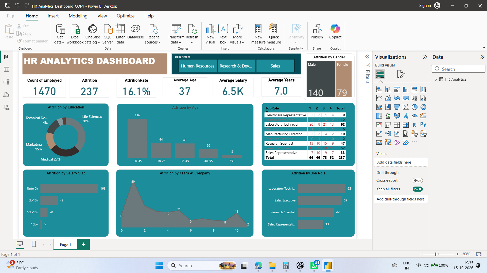

# HR Analytics Dashboard | Power BI

## Project Overview
This project presents an HR Analytics Dashboard built in **Microsoft Power BI** to explore workforce-related data and support HR reporting. The dashboard is designed to help users understand employee information and identify patterns in the workforce.

## Objectives
- Analyze HR data through interactive Power BI visuals.
- Present workforce information in an easy-to-understand format.
- Help users explore HR trends using dashboard filters and visual summaries.

## Tools & Technologies
- Microsoft Power BI
- Power Query (data preparation, where applicable)
- DAX (basic measures and calculations)

## Dashboard Preview
Add your dashboard screenshots to a folder named `screenshots` in this project and update the image paths below.



## Key Features
- Interactive dashboard visuals.
- HR data summaries and breakdowns.
- Filters/slicers for exploring the available data.


## Repository Structure
```text
HR_Analytics_Dashboard/
├── README.md
├── screenshots/
│   └── hr-analytics-dashboard.png
└── HR_Analytics_Dashboard.pbix
```

## How to View the Project
1. Download the `.pbix` file from this repository.
2. Open it using Microsoft Power BI Desktop.
3. Use the filters and visuals to explore the dashboard.

## Learning Outcomes
- Practised creating an interactive report in Power BI.
- Gained experience presenting HR-related data visually.
- Practised basic DAX and report design.
